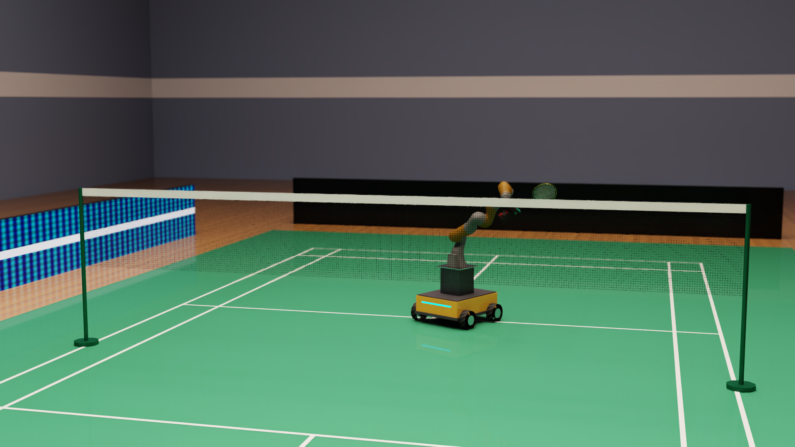

# Botminton

A Kuka iiwa 7 arm with an Allegro hand, on an omnidirectional wheeled base, learns to play badminton with
reinforcement learning in [Isaac Lab](https://github.com/isaac-sim/IsaacLab) (Isaac Sim 6.2, PhysX, rsl_rl PPO).
The hand holds a free racket by friction alone (no weld), and the shuttle flies with quadratic drag.



## What's here

The code is an Isaac Lab extension, installed as the Python package `badminton_rl`.

```
badminton_rl/            Isaac Lab extension (registers the gym tasks)
  tasks/badminton_env.py      one DirectRLEnv for every curriculum stage
  tasks/badminton_env_cfg.py  scene, physics, rewards and per-stage configs
  tasks/agents/               rsl_rl PPO runner configs
  assets/racket.usda          procedural racket
  training_hooks.py           optional critic warm-up patch for rsl_rl
scripts/                 evaluation, rollout/rally recording, path-traced rendering, checkpoint widening, probes
cluster/                 two-node (2x DGX Spark) training: launcher, crash-resuming supervisor, stage pipelines
```

## Tasks

All tasks are `Badminton-<Stage>-KukaAllegro`. Each stage warm-starts from the previous checkpoint.

| Stage | What the policy learns |
|---|---|
| `Grasp` / `MobileGrasp` | close the fingers on the racket, then hold it while swinging to commanded points (and riding base accelerations) |
| `Hit` / `MobileHit` | meet a launched shuttle and return it strongly upwards |
| `Target` / `MobileTarget` | clear the net and land near a randomised target in the far court |
| `Mobile` / `MobileCoverage` | the same, with shots spread over the whole half court; a scripted base drives under the intercept and the policy adds a residual |
| `MobileRally` | self-play: half the feeds are real returns recorded from two-robot rallies (`scripts/record_rally.py --bank_out`), after a random wait in a ready pose |

The stationary stages (`Grasp`, `Hit`, `Target`, `Mobile`) were the first curriculum; the `Mobile*` stages train
the wheeled robot from scratch with one fixed observation (113) / action (26) layout.

## Results (wheeled curriculum, deterministic policy, 2000 episodes)

| Court coverage (difficulty) | Hit | Over the net | In target |
|---|---|---|---|
| 0.3 | 94% | 86% | 62% |
| 0.5 | 94% | 71% | 49% |
| 1.0 (whole half court) | 62% | 31% | 21% |

Two-robot rallies (`scripts/record_rally.py`) are work in progress: the self-play stage is training the receiver
for the fast, flat returns a real opponent plays.

## Setup

Install Isaac Lab (the `uv` workflow; DGX Spark / aarch64 is supported), then install this package into its environment:

```bash
cd IsaacLab && uv pip install -e ../badminton_rl
```

On aarch64, Isaac Sim needs `LD_PRELOAD=/lib/aarch64-linux-gnu/libgomp.so.1`; `OPENBLAS_NUM_THREADS=1` avoids an
intermittent Kit startup crash.

## Usage

```bash
export OMNI_KIT_ACCEPT_EULA=YES LD_PRELOAD=/lib/aarch64-linux-gnu/libgomp.so.1 OPENBLAS_NUM_THREADS=1

# train a stage (warm-start with --checkpoint)
.venv/bin/isaaclab train --rl_library rsl_rl --task Badminton-MobileGrasp-KukaAllegro --num_envs 4096

# evaluate at a fixed curriculum difficulty
.venv/bin/python ../badminton_rl/scripts/evaluate.py --task Badminton-MobileCoverage-KukaAllegro \
    --checkpoint model.pt --episodes 2000 --difficulty 0.5

# record a rollout and render it with the RTX path tracer
.venv/bin/python ../badminton_rl/scripts/record_rollout.py --task Badminton-MobileCoverage-KukaAllegro \
    --checkpoint model.pt --episodes 30 --out rollout.npz
.venv/bin/python ../badminton_rl/scripts/render_showcase.py --rollout rollout.npz --out_dir showcase
.venv/bin/python ../badminton_rl/scripts/compose_showcase.py --render_dir showcase --out showcase.mp4

# two robots rallying, and a return bank for the self-play stage
.venv/bin/python ../badminton_rl/scripts/record_rally.py --checkpoint model.pt --out rally.npz \
    --bank_out ~/robotics/return_bank.npz --bank_size 8000
```

`cluster/` holds the scripts used to train across two DGX Sparks over a direct QSFP link (NCCL over RoCE);
addresses and interface names are those of that setup.
